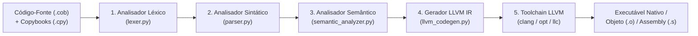

# COBython — Compilador COBOL com Backend LLVM

Compilador para a linguagem **COBOL** (*Common Business-Oriented Language*, formato fixo de 80 colunas), desenvolvido em Python puro e integrado à infraestrutura **LLVM** para geração de código intermediário (`.ll`), otimização e produção de executáveis nativos.

### Integrantes — Grupo 9
- **Thiago Costa** — Nº USP 14609529
- **Oliver Kuramae** — Nº USP 14601326
- **Theo Brito** — Nº USP 13688367

---

## Sumário
1. [Arquitetura do Pipeline](#1-arquitetura-do-pipeline)
2. [Dependências de Software](#2-dependências-de-software)
3. [Guia Rápido de Uso (`cobython.py`)](#3-guia-rápido-de-uso-cobythonpy)
4. [Opções de Linha de Comando (Estilo GCC / Clang)](#4-opções-de-linha-de-comando-estilo-gcc--clang)
5. [Execução Individual das Etapas do Pipeline](#5-execução-individual-das-etapas-do-pipeline)
6. [Níveis de Severidade de Diagnósticos (Seção 6)](#6-níveis-de-severidade-de-diagnósticos-seção-6)
7. [Como Acoplar Novos Backends (Transpiladores ou Assembly)](#7-como-acoplar-novos-backends-transpiladores-ou-assembly)

---

## 1. Arquitetura do Pipeline

O compilador implementa todas as etapas descritas na `ESPECIFICAÇÃO TEXTUAL.txt`:



| Arquivo | Etapa da Especificação | Responsabilidade Principal |
| :--- | :--- | :--- |
| `cobython.py` | **Driver CLI & Seção 6** | Interface unificada estilo GCC/Clang, formatação de diagnósticos (`I`, `W`, `E`, `S`), repasse de flags de otimização e carregamento de backends plugáveis. |
| `lexer.py` | **Seção 2 (Análise Léxica)** | Leitura do formato fixo (colunas 1–6, indicador na coluna 7, Área A nas colunas 8–11, Área B nas colunas 12–72), continuação de literais/palavras e diretiva `COPY`. |
| `parser.py` | **Seção 3 (Análise Sintática)** | Validação da ordem das 4 divisões (`IDENTIFICATION`, `ENVIRONMENT`, `DATA`, `PROCEDURE`), hierarquia de dados (`01`, `02-49`, `77`, `88`), cláusula `PIC` e geração da AST. |
| `semantic_analyzer.py` | **Seção 4 (Análise Semântica)** | Compatibilidade de tipos em `MOVE` (`PIC A` vs `PIC 9`), unicidade de escopo e qualificação `OF`, destinos de `PERFORM`/`GO TO` e associação de arquivos (`SELECT` $\leftrightarrow$ `FD`). |
| `llvm_codegen.py` | **Seção 5 (Geração de Código)** | Tradução da AST para Representação Intermediária da LLVM (`.ll`) em formato SSA, modelando registros contíguos em bytes com `getelementptr` e invocando o backend nativo. |

---

## 2. Dependências de Software

### Obrigatórias (Front-End, Middle-End e Emissão de `.ll`)
- **Python 3.10 ou superior** (utiliza apenas a biblioteca padrão do Python — **nenhum pacote externo via `pip` é necessário**).

### Recomendadas (Compilação de `.ll` para Executável Nativo, `.o` ou `.s`)
Para compilar o código intermediário LLVM (`.ll`) em executável binário nativo, código objeto (`.o`) ou assembly da arquitetura (`.s`), é necessário ter o **Clang** ou as ferramentas **LLVM + GCC** instaladas no `PATH`:

- **Ubuntu / Debian**:
  ```bash
  sudo apt update && sudo apt install clang llvm gcc
  ```
- **Fedora / RHEL**:
  ```bash
  sudo dnf install clang llvm gcc
  ```
- **Arch Linux**:
  ```bash
  sudo pacman -S clang llvm gcc
  ```

> **Nota**: Mesmo em ambientes sem `clang` ou `llc` instalados, o COBython executa toda a validação e gera normalmente o arquivo de representação intermediária `.ll` com a flag `-emit-llvm`.

---

## 3. Guia Rápido de Uso (`cobython.py`)

### Compilar e executar um programa COBOL
```bash
python3 cobython.py test.cob -o test
./test
```

### Compilar com otimização máxima (`-O3`) e modo verboso (`-v`)
```bash
python3 cobython.py test.cob -O3 -v -o test_otimizado
./test_otimizado
```

### Gerar apenas a Representação Intermediária LLVM (`.ll`)
```bash
# Sem otimização extra
python3 cobython.py test.cob -S -emit-llvm -o test.ll

# Com passes de otimização -O2 aplicados sobre o LLVM IR
python3 cobython.py test.cob -S -emit-llvm -O2 -o test_opt.ll
```

### Gerar Assembly nativo (`.s`) ou Código Objeto não linkado (`.o`)
```bash
# Assembly nativo da máquina alvo
python3 cobython.py test.cob -S -O2 -o test.s

# Objeto ELF (.o) sem executar o linker
python3 cobython.py test.cob -c -O2 -o test.o
```

### Executar apenas validação léxica, sintática e semântica (`-fsyntax-only`)
```bash
python3 cobython.py test.cob -fsyntax-only -Wall
```

---

## 4. Opções de Linha de Comando (Estilo GCC / Clang)

```text
uso: python3 cobython.py [opções] <arquivo.cob> ...
```

| Flag | Descrição |
| :--- | :--- |
| `-o <arquivo>` | Define o caminho do arquivo de saída. |
| `-O0`, `-O1`, `-O2`, `-O3`, `-Os`, `-Oz` | Define o nível de otimização repassado à infraestrutura LLVM (`clang`/`opt`/`llc`). |
| `-fsyntax-only` | Executa apenas análise léxica, sintática e semântica, sem gerar código. |
| `-S` | Compila apenas até código assembly nativo (`.s`), ou LLVM IR (`.ll`) quando combinado com `-emit-llvm`. |
| `-c` | Compila e monta gerando arquivo objeto (`.o`) ou bitcode LLVM (`.bc`), sem linkeditar. |
| `-emit-llvm` | Emite Representação Intermediária LLVM (`.ll` por padrão ou com `-S`; `.bc` com `-c`). |
| `-save-temps` | Mantém em disco os arquivos intermediários (`.ll`) gerados durante a compilação. |
| `-I <diretorio>` | Adiciona um diretório de busca para copybooks incluídos pela diretiva `COPY`. |
| `-g`, `--debug` | Ativa a compilação de linhas de depuração do COBOL (`D` na coluna 7) e símbolos de debug (`-g`). |
| `-Wall` | Habilita todos os avisos (`W`) e sugestões informativas (`I`). |
| `-Wno-info` | Oculta diagnósticos informativos de nível `I`. |
| `-w` | Suprime todos os avisos (`W`) e sugestões informativas (`I`), exibindo apenas erros (`E` e `S`). |
| `-Werror` | Trata qualquer aviso de nível `W` (*Warning*) como erro impeditivo (`E`). |
| `--backend <nome_ou_arq.py>` | Seleciona o gerador de código (padrão: `llvm` ou caminho de um plugin `.py`). |
| `--list-backends` | Lista os backends disponíveis e instruções para acoplar novos geradores. |
| `-Xllvm <flag>` | Repassa uma flag diretamente para o toolchain LLVM subjacente. |
| `--dump-tokens` | Imprime a tabela de tokens gerada pelo analisador léxico. |
| `--dump-ast` | Imprime a Árvore Sintática Abstrata (AST) gerada pelo analisador sintático. |
| `-v`, `--verbose` | Exibe passo a passo cada estágio executado e os comandos invocados. |
| `--version` | Exibe a versão do compilador. |

---

## 5. Execução Individual das Etapas do Pipeline

Cada módulo do compilador também pode ser invocado individualmente pela linha de comando para fins didáticos e de inspeção:

1. **Apenas Analisador Léxico (`lexer.py`)** — imprime a tabela de tokens e erros léxicos:
   ```bash
   python3 lexer.py test.cob [--debug]
   ```
2. **Até Analisador Sintático (`parser.py`)** — imprime a AST hierárquica e erros léxicos/sintáticos:
   ```bash
   python3 parser.py test.cob [--debug]
   ```
3. **Até Analisador Semântico (`semantic_analyzer.py`)** — imprime o flag de aprovação/reprovação e todos os erros acumulados:
   ```bash
   python3 semantic_analyzer.py test.cob [--debug]
   ```
4. **Gerador LLVM IR direto (`llvm_codegen.py`)** — gera `<programa>.ll` e tenta compilar o binário:
   ```bash
   python3 llvm_codegen.py test.cob [-o saida.ll] [--compile] [--debug]
   ```

---

## 6. Níveis de Severidade de Diagnósticos (Seção 6)

O COBython classifica todas as mensagens em quatro níveis de severidade conforme a Seção 6 da especificação:

- **`I` (*Informational*)**: Sugestões de estilo ou otimização (ex.: variáveis declaradas na `WORKING-STORAGE SECTION` e não referenciadas; blocos `IF` sem `END-IF` explícito). Não impedem a compilação.
- **`W` (*Warning*)**: Alertas de potenciais ambiguidades (ex.: níveis `01` ou `77` iniciados na Área B em vez da Área A; potencial truncamento de bytes em `MOVE`; uso de `GO TO`; tabulações expandidas). Não impedem a compilação (salvo quando `-Werror` é utilizado).
- **`E` (*Error*)**: Erros léxicos, sintáticos ou semânticos graves (ex.: palavras inválidas, divisões fora de ordem, falta de cláusula `PIC` em item elementar, `MOVE` incompatível entre `PIC A` e `PIC 9`, variáveis ou parágrafos não declarados, arquivos sem `SELECT` ou `FD`). **Falham a compilação e impedem a geração de código e linkedição.**
- **`S` (*Severe Error*)**: Falha catastrófica (ex.: inclusão recursiva infinita de copybooks via `COPY`, arquivo fonte inexistente ou ilegível). **Aborta imediatamente o processo de compilação.**

---

## 7. Como Acoplar Novos Backends (Transpiladores ou Assembly)

O `cobython.py` utiliza `llvm_codegen.py` como *middle-end* padrão, mas permite que novos transpiladores (para C, Python, Java, etc.) ou geradores de assembly direto sejam acoplados sem modificar o núcleo do compilador.

Basta criar um arquivo Python (por exemplo, `meu_transpilador.py`) herdando de `CodegenBackend`:

```python
from cobython import CodegenBackend, CompilerOptions
from parser import ProgramNode

class MeuTranspiladorC(CodegenBackend):
    name = "c-transpiler"
    description = "Transpilador de COBOL para C"
    default_extension = ".c"

    def generate(self, program: ProgramNode, options: CompilerOptions) -> str:
        # Percorre a AST (program) e retorna o código C correspondente
        return '#include <stdio.h>\nint main(void) { printf("Ola do C!\\n"); return 0; }\n'
```

E executá-lo passando `--backend`:

```bash
python3 cobython.py test.cob --backend meu_transpilador.py -o saida.c
```

---

## Licença

Distribuído sob a licença MIT. Consulte o arquivo [LICENSE](LICENSE) para mais informações.
