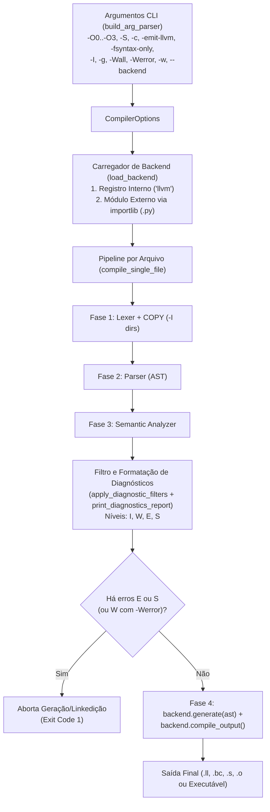

# Documentação Técnica: `cobython.py` (Driver CLI e Sistema de Diagnósticos)

## 1. Visão Geral e Papel no Pipeline
O módulo [`cobython.py`](../cobython.py) é o **driver unificado de usuário** do compilador COBython, projetado ao estilo de compiladores industriais como `gcc` e `clang`. Ele orquestra a execução sequencial de todas as fases de compilação ([`lexer.py`](../lexer.py) $\to$ [`parser.py`](../parser.py) $\to$ [`semantic_analyzer.py`](../semantic_analyzer.py) $\to$ [`llvm_codegen.py`](../llvm_codegen.py) ou plugins externos), implementa o sistema de notificação de erros e diretivas da **Seção 6 da `ESPECIFICAÇÃO TEXTUAL.txt`** e gerencia o acoplamento de novos *backends*.

---

## 2. Arquitetura Interna e Fluxo de Orquestração

---

## 3. Escolhas de Projeto e Decisões Técnicas

1. **Arquitetura Aberta para Backends Plugáveis (`CodegenBackend`)**:
   - Embora o `LLVMBackend` (baseado no `llvm_codegen.py`) seja o *middle-end* padrão, o `cobython.py` desacopla a validação (*front-end*) da geração de código (*back-end*) através da classe abstrata `CodegenBackend` e da função `load_backend()`.
   - O carregador dinâmico (`importlib.util.spec_from_file_location`) suporta três formatos de plugin em qualquer arquivo `.py` informado pelo usuário em `--backend`:
     1. Uma subclasse de `CodegenBackend` (implementando `generate(program, options)` e opcionalmente `compile_output(...)`).
     2. Uma função fábrica `create_backend()`.
     3. Uma simples função `generate(program, [options]) -> str` encapsulada automaticamente por `FunctionPluginBackend`.
   - Para evitar conflito de identidade de classes quando `cobython.py` é executado diretamente como `__main__`, o módulo registra a si mesmo em `sys.modules["cobython"]` na inicialização.

2. **Sistema Completo de Diagnósticos da Seção 6 (`I`, `W`, `E`, `S`)**:
   - Cada erro produzido em qualquer fase é encapsulado em um `StageDiagnostic(stage, error)`, preservando a origem (`LEXER`, `PARSER`, `SEMANTIC`, `DRIVER`) e a severidade:
     - **`I` (*Informational*)**: Sugestões de estilo (`IF` sem `END-IF`) e de otimização (variáveis declaradas na `WORKING-STORAGE` e não referenciadas).
     - **`W` (*Warning*)**: Ambiguidades e alertas não fatais (expansão de tabs, níveis `01`/`77` na Área B, truncamento potencial em `MOVE`, uso de `GO TO`).
     - **`E` (*Error*)**: Erros léxicos, sintáticos e semânticos graves que impedem a geração de código e a linkedição.
     - **`S` (*Severe*)**: Falhas catastróficas (ciclo infinito em `COPY`, arquivo inexistente/ilegível, falha interna de ferramenta).
   - A função `print_diagnostics_report()` exibe o trecho exato da linha original no código-fonte com um indicador visual `^` posicionado na coluna do token problemático, seguido de um resumo quantitativo por severidade.

3. **Repasse Transparente de Flags Estilo GCC/Clang para o LLVM**:
   - As flags clássicas de compiladores C/C++ são mapeadas diretamente para as ferramentas LLVM:
     - `-O0`, `-O1`, `-O2`, `-O3`, `-Os`, `-Oz` $\to$ repassadas ao `clang`, `opt` ou `llc`.
     - `-S -emit-llvm` $\to$ emite `.ll` (aplicando `opt`/`clang -S -emit-llvm` caso haja otimização ativa).
     - `-c -emit-llvm` $\to$ emite bitcode binário `.bc`.
     - `-S` $\to$ emite assembly nativo `.s` da arquitetura hospedeira.
     - `-c` $\to$ emite objeto ELF `.o` sem invocar o *linker*.
     - `-I <dir>` $\to$ estende a busca de copybooks da diretiva `COPY` para múltiplos diretórios de inclusão.

---

## 4. Pontos Fortes da Implementação

- **Experiência de Usuário Familiar (GCC/Clang)**: Suporta as convenções consagradas de linha de comando (`-o`, `-O3`, `-S`, `-c`, `-Wall`, `-Werror`, `-w`, `-v`, `-save-temps`, `-fsyntax-only`).
- **Extensibilidade Real sem Modificar o Core**: Novos transpiladores (ex.: COBOL $\to$ C ou COBOL $\to$ Python) ou geradores de assembly direto podem ser desenvolvidos em arquivos separados e testados imediatamente via `--backend`.
- **Limpeza Automática de Temporários**: Ao compilar diretamente para executável ou `.o`, utiliza `tempfile.NamedTemporaryFile` em bloco `try...finally` para não deixar arquivos `.ll` residuais no diretório do projeto (a menos que `-save-temps` seja especificado).

---

## 5. Pontos Fracos / Limitações e Trabalhos Futuros

- **Compilação Independente por Arquivo de Entrada**: Quando múltiplos arquivos `.cob` são passados na mesma invocação, `cobython.py` compila cada um sequencialmente de forma independente, em vez de realizar linkedição conjunta de múltiplos módulos objeto (`.o`) em um único executável final.
- **Ausência de `source_map` para Copybooks na Impressão da Linha**: Na exibição do trecho de código com o cursor `^`, `print_diagnostics_report()` indexa `source_lines` do arquivo principal; se um erro ocorrer dentro de um copybook incluído via `COPY`, o ponteiro de linha usará o índice de linha do `.cpy` sobre o buffer do arquivo principal.
