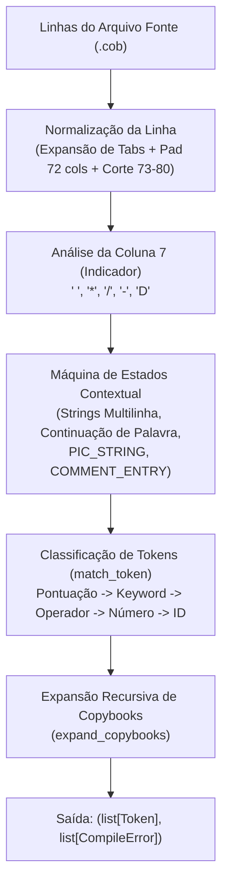

# Documentação Técnica: `lexer.py` (Analisador Léxico)

## 1. Visão Geral e Papel no Pipeline
O módulo [`lexer.py`](../lexer.py) implementa a **Etapa 1 (Análise Léxica)** e o pré-processamento da diretiva `COPY` conforme as **Seções 2 e 6 da `ESPECIFICAÇÃO TEXTUAL.txt`**. Sua responsabilidade é transformar o código-fonte COBOL em formato de referência fixo (*Fixed Format*, 80 colunas por linha) em uma sequência linear de tokens (`list[Token]`) acompanhada de uma lista de diagnósticos (`list[CompileError]`).

---

## 2. Arquitetura Interna e Estruturas de Dados

### Estruturas Principais
- **`Token(NamedTuple)`**:
  - `line: int`: Número da linha (base 1).
  - `col: int`: Coluna inicial do token (base 1).
  - `area: str`: `"AREA_A"` (colunas 8–11) ou `"AREA_B"` (colunas 12–72).
  - `type: str`: Categoria léxica (`IDENTIFICATION`, `VALID_ID`, `NUMBER`, `ALPHANUMERIC_LITERAL`, `PIC_STRING`, `DOT`, etc.).
  - `value: str`: Lexema original (normalizado em maiúsculas fora de literais e `COMMENT_ENTRY`).
- **`CompileError(NamedTuple)`**:
  - `severity: str`: Nível de severidade da Seção 6 (`"I"`, `"W"`, `"E"`, `"S"`).
  - `line: int`, `col: int`, `message: str`.

---

## 3. Escolhas de Projeto e Decisões Técnicas

1. **Tratamento Estrito das Colunas (Seção 2.1)**:
   - Cada linha é preenchida à direita com espaços até 72 caracteres (`line.ljust(72, " ")`). Isso descarta automaticamente as colunas 73–80 (Área de Identificação do Programa) pelo laço de varredura `while i < 72` e evita `IndexError` em linhas curtas.
   - As colunas 1–6 (Área de Sequência) são ignoradas ao iniciar a leitura no índice `6` (coluna 7) e a varredura de código no índice `7` (coluna 8).
   - Caso haja tabulações (`\t`), o lexer emite um aviso `W` (*Warning*) e expande os tabs (`expandtabs(8)`), preservando a compilação mas alertando sobre o possível desalinhamento de colunas.

2. **Sensibilidade ao Contexto Léxico (`PIC_STRING` e `COMMENT_ENTRY`)**:
   - Em COBOL, a máscara que sucede `PIC` ou `PICTURE [IS]` (como `S9(05)V99` ou `-ZZZZZZZZZ9.99`) contém parênteses, sinais e pontos decimais que, fora desse contexto, seriam quebrados em múltiplos tokens ou confundidos com o ponto final de sentença. O lexer ativa o flag `expect_pic_string` ao encontrar `PIC`/`PICTURE`, consumindo toda a máscara contígua até o espaço e separando apenas o ponto final (`.`) caso encerre a declaração.
   - Da mesma forma, parágrafos informativos da `IDENTIFICATION DIVISION` (`AUTHOR.`, `REMARKS.`, `DATE-WRITTEN.`, etc.) contêm texto livre (*comment-entry*). O lexer usa os estados `expect_comment_entry` e `in_comment_entry` para capturar o texto livre na Área B (inclusive em múltiplas linhas, enquanto a Área A permanecer vazia) sem tokenizá-lo como código.

3. **Desambiguação do Ponto Final (`.`) vs. Ponto Decimal**:
   - O ponto (`.`) é simultaneamente separador decimal em literais numéricos (`-123.45`) e terminador sintático crítico de sentenças/declarações.
   - O lexer consome a palavra inteira e verifica se ela termina com `.`: caso termine, destaca o `.` final como um token `DOT` independente e valida o prefixo com a expressão regular `number_regex` (que exige dígitos após qualquer ponto decimal interno).

4. **Continuação de Literais e Palavras (Coluna 7 = `-`)**:
   - Suporta tanto a continuação padrão de literais alfanuméricos (buscando o delimitador `"` ou `'` de reabertura na Área B e tratando aspas escapadas `""` / `''`) quanto a continuação de palavras/identificadores quebrados na coluna 72 (removendo o token parcial da linha anterior com `token_stream.pop()`, concatenando os lexemas e reclassificando a palavra completa).

5. **Expansão Pós-Léxica de Copybooks (`expand_copybooks`)**:
   - A diretiva `COPY [Nome].` é resolvida operando sobre o `token_stream`, mantendo um conjunto imutável `open_copybooks: frozenset[str]` com os caminhos abertos na pilha de inclusão. Caso um copybook inclua a si mesmo direta ou indiretamente, o lexer detecta o ciclo e emite um erro de nível **`S` (*Severe Error*)**.

---

## 4. Pontos Fortes da Implementação

- **Fidelidade ao Formato Fixo Tradicional**: Trata com precisão Área A, Área B, comentários (`*` e `/`), linhas de depuração (`D`/`d` controladas por `--debug`) e continuação (`-`).
- **Tolerância a Falhas sem Interrupção Precoce**: Em vez de abortar no primeiro erro léxico, emite tokens de erro (`ERROR_INVALID_ID`, `ERROR_ID_TOO_BIG`, `ERROR_UNCLOSED_STRING`) no fluxo e registra o `CompileError`, permitindo que o `parser.py` sincronize a análise sem gerar erros em cascata falsos.
- **Zero Dependências Externas**: Implementado inteiramente com `re` e estruturas nativas do Python.

---

## 5. Pontos Fracos / Limitações e Trabalhos Futuros

- **Tabela Restrita de `KEYWORDS` Explícitas**: Apenas o conjunto nuclear de palavras reservadas da especificação está listado em `KEYWORDS`; verbos estendidos do COBOL (como `EVALUATE`, `SEARCH`, `INSPECT`, `COMPUTE`) são emitidos como `VALID_ID`, exigindo que o `parser.py` faça verificação contextual por `token.value`.
- **Rastreamento de Nome de Arquivo em Copybooks**: Quando um copybook é expandido via `COPY`, os tokens inseridos mantêm o número de linha relativo ao arquivo `.cpy`, mas a tupla `Token` não armazena um campo `filename: str`, o que faz diagnósticos em copybooks exibirem o número da linha do `.cpy` sob o contexto do arquivo principal.
- **Diretiva `COPY ... REPLACING`**: Suporta `COPY [Nome].` simples, mas ainda não implementa a cláusula opcional `REPLACING ==A== BY ==B==` do padrão COBOL completo.
