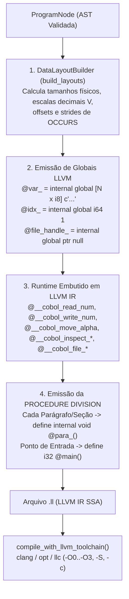

# Documentação Técnica: `llvm_codegen.py` (Gerador de Código LLVM IR)

## 1. Visão Geral e Papel no Pipeline
O módulo [`llvm_codegen.py`](../llvm_codegen.py) implementa a **Etapa 4 (Geração de Código Intermediário e Tradução)** conforme a **Seção 5 da `ESPECIFICAÇÃO TEXTUAL.txt`**. Ele traduz a Árvore Sintática Abstrata (`ProgramNode`) já validada pelo [`semantic_analyzer.py`](../semantic_analyzer.py) para um módulo completo em **Representação Intermediária da LLVM (`.ll`)** em formato textual SSA (*Static Single Assignment*), e aciona opcionalmente a suíte LLVM (`clang`, `opt`, `llc`) para gerar código de máquina nativo.

---

## 2. Arquitetura Interna e Modelo de Memória



### Representação de Memória Contígua da `DATA DIVISION`
Um dos aspectos mais desafiadores do COBOL é o seu modelo de memória baseado em registros contíguos de caracteres (*DISPLAY format*):
- Quando um programa declara um grupo `01` com subcampos `02`, `03` e cláusulas `OCCURS`, todos os subcampos compartilham **o mesmo bloco contíguo de bytes**.
- Por exemplo, em `prog004_folha_pgto`:
  ```cobol
  01 TAB-TRABALHADOR.
     02 TRABALHADOR OCCURS 3 TIMES INDEXED BY TID.
        03 NOME    PIC X(5).
        03 SALARIO PIC 9(5)V99.
        03 DPTO    PIC X(2) VALUES SPACES OCCURS 2 TIMES.
  ```
  O `LLVMIRGenerator` calcula:
  - `NOME`: 5 bytes (offset relativo `0`)
  - `SALARIO`: 7 bytes, escala decimal `2` (`V` ocupa 0 bytes físicos; offset relativo `5`)
  - `DPTO`: 2 bytes $\times$ 2 ocorrências = 4 bytes (offset relativo `12`, stride interno `2`)
  - `TRABALHADOR`: $5 + 7 + 4 = 16$ bytes por ocorrência $\times$ 3 ocorrências = **48 bytes** (stride externo `16`).
- O registro raiz é alocado como um único buffer global LLVM:
  ```llvm
  @var_TAB_TRABALHADOR_17 = internal global [48 x i8] c"..."
  ```
- Qualquer acesso indexado como `DPTO(IDX, 2)` é traduzido diretamente em instruções aritméticas SSA + `getelementptr inbounds i8, ptr @var_TAB_TRABALHADOR_17, i64 %offset`:
  $$\text{offset} = \text{base\_offset} + (\text{IDX} - 1) \times 16 + (2 - 1) \times 2$$
- Graças a essa escolha, um único `MOVE "JOSEA1111111A1A4..." TO TAB-TRABALHADOR` copia os 48 bytes para `@var_TAB_TRABALHADOR_17` e todos os subcampos (`NOME(1)`, `SALARIO(1)`, `DPTO(1, 2)`) passam imediatamente a conter seus valores corretos, sem necessidade de sincronização ou *marshalling*.

---

## 3. Escolhas de Projeto e Decisões Técnicas

1. **Geração Direta de Texto `.ll` com Ponteiros Opacos (`ptr`)**:
   - A partir do LLVM 15+, o padrão da infraestrutura LLVM é o uso de *opaque pointers* (`ptr` em vez de `i8*` ou `[10 x i8]*`). Emitir LLVM IR moderno com `ptr` simplifica drasticamente as instruções `load`, `store`, `call` e `getelementptr`, além de ser compatível com as versões atuais do `clang` e `llc` sem depender da biblioteca C++ `llvmlite` (que frequentemente apresenta conflitos de versão do LLVM).

2. **Biblioteca de Runtime Embutida em LLVM IR Puro (`_LLVM_RUNTIME_HELPERS`)**:
   - Em vez de exigir que o usuário compile e linke um arquivo `.c` externo de runtime a cada compilação, todas as rotinas de suporte (`@__cobol_read_num`, `@__cobol_write_num`, `@__cobol_move_alpha`, `@__cobol_cmp_alpha`, `@__cobol_accept`, `@__cobol_inspect_tally`, `@__cobol_inspect_replace`, `@__cobol_inspect_convert`, `@__cobol_file_*`) foram escritas diretamente em LLVM IR como funções `define internal` dentro do próprio módulo `.ll`.
   - Como são marcadas como `internal`, quando o usuário compila com `-O2` ou `-O3`, o otimizador do LLVM faz *inlining* das funções críticas e elimina completamente (*Dead Code Elimination*) qualquer rotina de runtime não utilizada pelo programa.

3. **Segurança contra *Overlapping* em `@__cobol_move_alpha` (`memmove`)**:
   - Instruções como `MOVE FUNCTION UPPER-CASE(WKS-OPCAO) TO WKS-OPCAO` têm o mesmo endereço de origem e destino. A rotina `@__cobol_move_alpha` utiliza o intrínseco `@llvm.memmove.p0.p0.i64` para copiar os primeiros $\min(\text{dst\_len}, \text{src\_len})$ bytes antes de preencher a cauda restante com espaços (`0x20`), evitando sobrescrever a origem antes da leitura.

4. **Modelagem de Parágrafos como Funções Internas (`@para_<NOME>`)**:
   - Em COBOL, um parágrafo pode ser executado tanto por queda livre sequencial (*fallthrough* a partir do início da `PROCEDURE DIVISION`) quanto invocado como sub-rotina via `PERFORM <paragrafo> [UNTIL <cond>]` (retornando ao ponto de chamada ao terminar).
   - Emitir cada parágrafo como `define internal void @para_<NOME>()` permite que `PERFORM` seja traduzido para um simples `call void @para_<NOME>()` (ou um laço `perform.cond` $\to$ `perform.body` $\to$ `perform.end`), enquanto `@main()` chama os parágrafos na ordem sequencial até encontrar `STOP RUN` (`call void @exit(i32 0)`).

---

## 4. Pontos Fortes da Implementação

- **Autocontido e Zero Dependências Python**: Gera arquivos `.ll` completos que dependem exclusivamente da `libc`/`libm` padrão do sistema operacional.
- **Compatibilidade com Toda a Infraestrutura LLVM**: O código `.ll` gerado passa sem erros nem avisos pelo verificador SSA do `clang`/`opt`/`llc` em todos os níveis de otimização (`-O0` a `-O3`, `-Os`, `-Oz`).
- **Inicialização em Tempo de Compilação**: As cláusulas `VALUE`/`VALUES` (inclusive dentro de grupos com subcampos e `OCCURS`, como o nome de arquivo composto `WS-PROD-FILENAME` em `prog007_loja`) são calculadas estaticamente em Python e gravadas diretamente no inicializador global `c"..."` do `.ll`.

---

## 5. Pontos Fracos / Limitações e Trabalhos Futuros

- **Aritmética Intermediária em Ponto Flutuante (`double`)**:
  - Embora o armazenamento em memória respeite o formato ASCII zonado com casas decimais implícitas (`V`), as operações aritméticas intermediárias (`ADD`, `SUBTRACT`, `MULTIPLY`, `DIVIDE`, `COMPUTE`) convertem os operandos para `double` (IEEE 754 de 64 bits) e arredondam de volta para o buffer decimal. Para valores financeiros com mais de 15 dígitos significativos, uma implementação futura com inteiros de 128 bits escalados (`i128`) evitaria imprecisões de representação binária.
- **Arquivos `ORGANIZATION INDEXED` Emulados Sequencialmente**:
  - As operações `OPEN`, `READ`, `WRITE`, `CLOSE` e `START` operam sobre arquivos planos via `fopen`/`fread`/`fwrite` da `libc`. Um suporte completo a arquivos indexados ISAM (`RECORD KEY` / `ALTERNATE RECORD KEY` com busca por chave em disco) exigiria vincular uma biblioteca de índices como Berkeley DB ou GDBM.
- **Semântica de `GO TO` Inter-Parágrafos**:
  - Como cada parágrafo é compilado em uma função `@para_<NOME>()`, a instrução `GO TO <destino>` é traduzida como uma chamada em cauda (`call void @para_<DESTINO>()` seguida de `ret void`), o que funciona para desvios simples mas pode retornar aos parágrafos subsequentes em `@main()` caso o fluxo desviado não execute `STOP RUN`.
