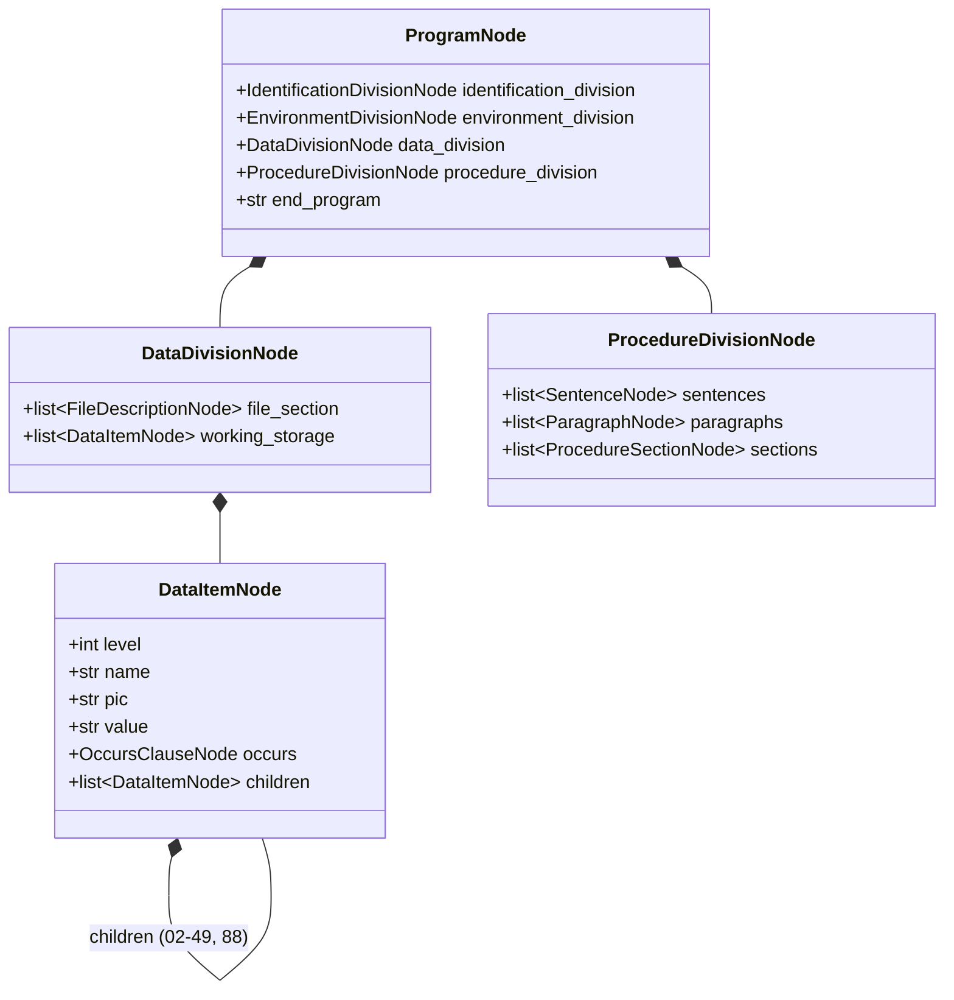

# Documentação Técnica: `parser.py` (Analisador Sintático)

## 1. Visão Geral e Papel no Pipeline
O módulo [`parser.py`](../parser.py) implementa a **Etapa 2 (Análise Sintática)** do compilador COBython, conforme a **Seção 3 da `ESPECIFICAÇÃO TEXTUAL.txt`**. Ele consome a lista de tokens gerada pelo [`lexer.py`](../lexer.py), valida a estrutura gramatical das quatro divisões da linguagem COBOL e constrói a **Árvore Sintática Abstrata (AST)** tipada em nós `dataclass`, além de emitir diagnósticos sintáticos (`E` e `W`).

---

## 2. Arquitetura Interna e Hierarquia da AST

### Abordagem de Parsing
O `Parser` utiliza a técnica de **Descida Recursiva Preditiva (*Recursive Descent*)** com *lookahead* arbitrário (`current()` e `peek(offset)`), combinada com:
1. **Pilha de Níveis na `DATA DIVISION`**: reconstrói a árvore hierárquica de registros (`01` $\to$ `02` $\to$ `03` ... e `88`) a partir da sequência linear de declarações.
2. **Sub-parser de Precedência de Operadores**: analisa expressões aritméticas (`+`, `-`, `*`, `/`, `**` com associatividade à direita e unários) e condições booleanas (`OR`, `AND`, `NOT`, relacionais e condições relacionais abreviadas).

---

## 3. Escolhas de Projeto e Decisões Técnicas

1. **Reconhecimento de Palavras-Chave Contextuais (`match_word`)**:
   - Para manter 100% de compatibilidade com a saída do `lexer.py` (que classifica verbos adicionais como `ADD`, `EVALUATE`, `INSPECT`, `END-IF` como `VALID_ID`), o método `match_word()` verifica tanto `token.type` quanto `token.value` (excluindo literais alfanuméricos). Isso permitiu expandir a gramática para cobrir toda a suíte de testes sem alterar os tokens produzidos pelo lexer.

2. **Tratamento de `IF / ELSE` Aninhados com e sem `END-IF`**:
   - O COBOL permite encerrar múltiplos blocos `IF ... ELSE IF ... ELSE ...` de duas maneiras: individualmente com `END-IF` (COBOL-85) ou todos simultaneamente com um único ponto final (`.`) da sentença (COBOL-74, utilizado em `prog007_loja.cob`).
   - Em `parse_if_stmt()`, os blocos `then_body` e `else_body` consomem instruções até encontrar um delimitador de escopo (`ELSE`, `END-IF`, `WHEN`, `END-EVALUATE`, `END-SEARCH`) ou o ponto final (`DOT`) da sentença. Ao parar imediatamente antes de `ELSE` ou `DOT`, a recursão desempilha limpa e associa cada `ELSE` ao `IF` aberto correspondente.

3. **Suporte a Condições Relacionais Abreviadas (*Abbreviated Combined Relation Conditions*)**:
   - Construções típicas de COBOL como `IF WKS-OPCAO = "S" OR "U" OR "M"` omitem o sujeito (`WKS-OPCAO`) e o operador (`=`) após o `OR`.
   - O método `_parse_or_condition()` e `_parse_and_condition()` propagam a última `RelationConditionNode` (`inherited_rel`) para os ramos seguintes: se o operando à direita de `OR`/`AND` não for seguido por um operador relacional próprio, o parser reconstrói explicitamente na AST o nó `RelationConditionNode(left=inherited_rel.left, operator=inherited_rel.operator, right=expr)`.

4. **Absorção de Tokens de Erro Léxico sem Cascata Sintática**:
   - O conjunto `IDENTIFIER_TOKEN_TYPES = {"VALID_ID", "ERROR_INVALID_ID", "ERROR_ID_TOO_BIG"}` permite que um identificador que falhou na análise léxica (por exemplo, por conter `_` ou ter mais de 30 caracteres) ainda seja aceito sintaticamente na posição de um identificador na AST. Dessa forma, o erro léxico original é preservado sem causar dezenas de falsos erros sintáticos na mesma linha.

5. **Validação de Área A vs. Área B como *Warning* (`W`)**:
   - Cabeçalhos de divisão/seção e níveis `01`/`77` posicionados na Área B (colunas 12–72, como ocorre em `prog002_operacoes` e `prog003_calculadora`) geram diagnósticos de severidade `W` (*Warning*), respeitando a Seção 2.1 sem impedir a compilação (Seção 6).

---

## 4. Pontos Fortes da Implementação

- **AST Rica e Fortemente Tipada**: Utiliza mais de 30 classes `@dataclass` específicas para cada divisão, seção, item de dados, comando e expressão, facilitando tanto a análise semântica quanto múltiplos backends de geração de código.
- **Recuperação de Erros (*Panic Mode*) Eficiente**: O método `recover_to_dot_or_header()` sincroniza o parser no próximo ponto final (`.`) ou início de parágrafo/seção/divisão na Área A, permitindo diagnosticar vários erros sintáticos independentes em uma única execução.
- **Montagem e Validação Hierárquica da `DATA DIVISION`**: Valida automaticamente se itens de grupo não possuem `PIC`, se itens elementares (folhas da árvore e nível `77`) possuem `PIC` obrigatório e se subcampos `02-49` estão subordinados a um registro `01`.

---

## 5. Pontos Fracos / Limitações e Trabalhos Futuros

- **Cláusulas `INSPECT` Armazenadas de Forma Semi-Estruturada**: Enquanto comandos aritméticos e de controle possuem sub-nós detalhados na AST, o nó `InspectStmt` armazena os modificadores subsequentes (`FOR ALL ... BEFORE INITIAL ...`) como uma lista de strings (`clauses: list[str]`), delegando parte da interpretação posicional ao analisador semântico e ao gerador de código.
- **Ausência de Cláusulas `REDEFINES` e `RENAMES` (Nível 66)**: O parser valida os níveis `01`, `02-49`, `77` e `88` definidos na especificação, mas não inclui suporte ao nível `66` (`RENAMES`) nem à cláusula `REDEFINES`.
- **Subprogramas (`CALL ... USING` e `LINKAGE SECTION`)**: O foco está em programas autocontidos; chamadas externas entre múltiplos módulos COBOL via `LINKAGE SECTION` ainda não fazem parte da gramática.
