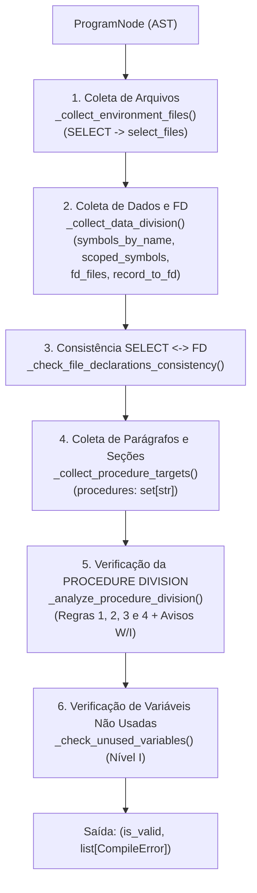

# Documentação Técnica: `semantic_analyzer.py` (Analisador Semântico)

## 1. Visão Geral e Papel no Pipeline
O módulo [`semantic_analyzer.py`](../semantic_analyzer.py) implementa a **Etapa 3 (Análise Semântica / Verificações)** conforme a **Seção 4 da `ESPECIFICAÇÃO TEXTUAL.txt`**, além de contribuir com diagnósticos de nível `I` (*Informational*), `W` (*Warning*) e `E` (*Error*) previstos na **Seção 6**. Ele recebe o `ProgramNode` (AST) construído pelo [`parser.py`](../parser.py) e retorna `(is_valid: bool, errors: list[CompileError])`.

---

## 2. Arquitetura Interna e Tabela de Símbolos

### Estruturas Principais
- **`SymbolEntry`**:
  - `name: str`, `level: int`
  - `category: str`: Classificação semântica derivada do `PIC` e da estrutura (`"NUMERIC"`, `"ALPHABETIC"`, `"ALPHANUMERIC"`, `"GROUP"`, `"CONDITION"`, `"INDEX"`).
  - `pic: str | None`: Máscara `PICTURE` original.
  - `ancestors: tuple[str, ...]`: Tupla ordenada com os nomes dos grupos ancestrais desde o nível `01` até o grupo pai imediato.
  - `scope_parent: str`: Nome do pai imediato ou `"<GLOBAL>"` (para níveis `01`, `77` e índices).

---

## 3. Escolhas de Projeto e Decisões Técnicas

1. **Resolução de Escopo e Qualificação Hierárquica `OF` (Regra 2)**:
   - O COBOL permite que subcampos em registros distintos tenham o mesmo nome (ex.: `02 NOME` dentro de `01 CLIENTE` e `02 NOME` dentro de `01 FORNECEDOR`), desde que sejam qualificados com `OF` / `IN` ao serem referenciados.
   - Para modelar essa regra com exatidão, a tabela de símbolos utiliza duas estruturas complementares:
     - `scoped_symbols: dict[tuple[str, str], SymbolEntry]`: indexada por `(scope_parent, name)`, detecta imediatamente declarações duplicadas **no mesmo escopo** (que nem mesmo `OF` poderia desambiguar).
     - `symbols_by_name: dict[str, list[SymbolEntry]]`: agrupa todas as variáveis homônimas do programa. Quando uma instrução referencia `X` sem qualificadores e `len(symbols_by_name["X"]) > 1`, emite erro `E` de ambiguidade; quando referencia `X OF G1 OF G2`, o método `_matches_qualification()` verifica se `[G1, G2]` é uma subsequência válida de `reversed(cand.ancestors)` (permitindo qualificação parcial ou total, exatamente como no padrão ANSI COBOL).

2. **Registro Automático de Índices Implícitos (`INDEXED BY`)**:
   - Em COBOL, variáveis de índice declaradas na cláusula `OCCURS N TIMES INDEXED BY TID` (como `TID` em `prog004_folha_pgto` e `prog006_files`) não possuem entrada explícita de nível `77` ou `01`. O analisador semântico cria entradas `SymbolEntry(category="INDEX")` automaticamente no escopo global ao visitar cláusulas `OCCURS`.

3. **Distinção entre Arquivo (`FD`) e Registro (`01`) no Comando `WRITE` (Regra 4)**:
   - Enquanto `OPEN`, `READ`, `CLOSE` e `START` recebem o nome do **arquivo** (declarado em `SELECT` e `FD`), a instrução `WRITE` em COBOL recebe o nome do **registro `01`** subordinado ao `FD` (ex.: `WRITE RC-TRABALHADOR` para o arquivo `MY-FILE`).
   - O analisador mantém o dicionário `record_to_fd: dict[str, str]` que mapeia cada registro `01` da `FILE SECTION` ao seu respectivo `FD`, garantindo que `WRITE` valide tanto a existência do registro no `FD` quanto a presença do arquivo correspondente no `FILE-CONTROL` (`SELECT`).

4. **Prevenção de Diagnósticos Duplicados sobre Erros Léxicos**:
   - Se o nome de um identificador já é léxicamente inválido (ex.: `2.0.1` ou `CONT@`), `resolve_identifier()` verifica `user_identifier_regex` e ignora a emissão de `"Variável não declarada"`, evitando poluir a saída com dois erros sobre o mesmo token.

5. **Geração de Diagnósticos `I` (Informational) e `W` (Warning) da Seção 6**:
   - Além dos erros impeditivos (`E`), o analisador rastreia o conjunto `referenced_names` (propagando referências entre grupos pais e subcampos) para emitir sugestões de otimização (`I`) sobre variáveis não utilizadas na `WORKING-STORAGE SECTION`, sugestões de estilo (`I`) para `IF` sem `END-IF`, e alertas (`W`) para potencial truncamento em `MOVE` (quando `compute_pic_byte_size(origem) > compute_pic_byte_size(destino)`) e uso de `GO TO`.

---

## 4. Pontos Fortes da Implementação

- **Cobertura Integral da Seção 4**: Valida rigorosamente compatibilidade de `MOVE` (incluindo literais, constantes figurativas e cláusulas `VALUE` iniciais), unicidade/qualificação `OF`, destinos de `PERFORM` (inclusive `THRU`) / `GO TO` e associação cruzada `SELECT` $\leftrightarrow$ `FD`.
- **Suporte a Qualificação Parcial em Hierarquias Profundas**: O algoritmo de subsequência em `ancestors` suporta árvores de registros com qualquer profundidade (`01` $\to$ `02` $\to$ `03` ...).
- **Separação Clara entre Validação e Geração de Código**: Retorna uma estrutura limpa `(bool, list[CompileError])` sem efeitos colaterais na AST.

---

## 5. Pontos Fracos / Limitações e Trabalhos Futuros

- **Rastreamento de Variáveis Não Utilizadas por Nome Simples**: O conjunto `referenced_names` rastreia nomes simples usados; se houver duas variáveis homônimas em grupos distintos e apenas uma for usada (qualificada com `OF`), a segunda não será sinalizada com o aviso informativo `I` de variável não utilizada.
- **Verificação de Limites Estáticos de Subscritos (`OCCURS`)**: O analisador valida se os subscritos são expressões com variáveis declaradas, mas ainda não verifica estaticamente se um subscrito literal constante (ex.: `NOME(5)` em uma tabela `OCCURS 3 TIMES`) excede o limite declarado.
- **Análise de Fluxo de Dados em `PERFORM THRU`**: Verifica se ambos os parágrafos de início e fim existem na `PROCEDURE DIVISION`, mas não emite erro caso o parágrafo final tenha sido declarado antes do parágrafo inicial no texto.
