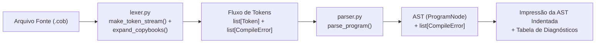

# Plano de Implementação: Analisador Sintático (`parser.py`)

## Objetivo
Implementar o módulo [parser.py](file:///home/coscal/JD/10-19_Projetos/10_Projetos_Correntes/COBython/parser.py), responsável pela **Parte 3 (Análise Sintática / Parser)** da [ESPECIFICAÇÃO TEXTUAL.txt](file:///home/coscal/JD/10-19_Projetos/10_Projetos_Correntes/COBython/ESPECIFICAÇÃO%20TEXTUAL.txt). O `parser.py` receberá o fluxo de tokens (`list[Token]`) e a lista de diagnósticos (`list[CompileError]`) produzidos pelo [lexer.py](file:///home/coscal/JD/10-19_Projetos/10_Projetos_Correntes/COBython/lexer.py), construirá a **Árvore Sintática Abstrata (AST)** do programa COBOL, reportará erros e avisos sintáticos com recuperação de falhas (*panic-mode* sincronizado por `.` e cabeçalhos) e imprimirá a AST de forma hierárquica seguida da tabela de diagnósticos.

---

## Arquitetura e Fluxo de Compilação



> [!NOTE]
> **Compatibilidade com `lexer.py`**: O `lexer.py` não precisará ser alterado de forma incompatível. Palavras-chave contextuais da linguagem que o `lexer.py` emite como `VALID_ID` (ex.: `ADD`, `SUBTRACT`, `MULTIPLY`, `DIVIDE`, `COMPUTE`, `EVALUATE`, `SEARCH`, `SET`, `INSPECT`, `END-IF`, `UNTIL`, `GIVING`, `VALUES`, `OCCURS`, `END`, `PROGRAM`, etc.) serão reconhecidas pelo parser verificando o valor do token (`token.value`), mantendo 100% de compatibilidade com as saídas já validadas em `resultados_lexer/`.

---

## Alterações Propostas

### Analisador Sintático (Parser)

#### [NEW] [parser.py](file:///home/coscal/JD/10-19_Projetos/10_Projetos_Correntes/COBython/parser.py)

1. **Importação e Integração com `lexer.py`**:
   - Importará `Token`, `CompileError`, `make_token_stream` e `expand_copybooks` diretamente de [lexer.py](file:///home/coscal/JD/10-19_Projetos/10_Projetos_Correntes/COBython/lexer.py).
   - Exporá a função principal `parse(token_stream: list[Token], errors: list[CompileError] | None = None) -> tuple[ProgramNode, list[CompileError]]`.
   - Na CLI (`python parser.py <arquivo_fonte.cob> [--debug]`), lerá o arquivo `.cob`, executará `make_token_stream` + `expand_copybooks`, invocará `parse()`, imprimirá a AST hierárquica e a tabela de erros/avisos (`SEV | LINHA | COL | MENSAGEM`), retornando código de saída `1` caso haja erros de severidade `E` ou `S`.

2. **Nós da Árvore Sintática Abstrata (AST)** (usando `dataclass`):
   - **Raiz e Divisões**:
     - `ProgramNode`: `identification_div`, `environment_div` (opcional), `data_div` (opcional), `procedure_div`, `end_program_name` (opcional).
     - `IdentificationDivisionNode`: `program_id: str`, `paragraphs: list[CommentParagraphNode]` (`AUTHOR`, `INSTALLATION`, `DATE-WRITTEN`, `DATE-COMPILED`, `SECURITY`, `REMARKS`).
     - `EnvironmentDivisionNode`: `configuration_section: ConfigurationSectionNode | None`, `input_output_section: InputOutputSectionNode | None`.
     - `ConfigurationSectionNode`: `source_computer: str | None`, `object_computer: str | None`.
     - `InputOutputSectionNode`: `file_controls: list[SelectNode]`.
     - `SelectNode`: `file_name: str`, `assign_to: str`, `clauses: list[SelectClauseNode]` (`ORGANIZATION`, `ACCESS MODE`, `RECORD KEY`, `ALTERNATE RECORD KEY`, `FILE STATUS`).
     - `DataDivisionNode`: `file_section: list[FileDescriptionNode]`, `working_storage: list[DataItemNode]`.
     - `FileDescriptionNode` (`FD`): `file_name: str`, `clauses: list[str]`, `records: list[DataItemNode]`.
     - `DataItemNode`: `level: int` (`01`, `02-49`, `77`, `88`), `name: str`, `pic: str | None`, `value: str | None`, `occurs: OccursClauseNode | None`, `children: list[DataItemNode]`.
     - `ProcedureDivisionNode`: `sections: list[ProcedureSectionNode]`, `paragraphs: list[ParagraphNode]`, `sentences: list[SentenceNode]` (para sentenças antes do primeiro parágrafo, se houver).
     - `ProcedureSectionNode`: `name: str`, `paragraphs: list[ParagraphNode]`, `sentences: list[SentenceNode]`.
     - `ParagraphNode`: `name: str`, `sentences: list[SentenceNode]`.
     - `SentenceNode`: `statements: list[StatementNode]`.
   - **Instruções (`StatementNode`) e Expressões**:
     - Nós específicos para cada comando:
       - `DisplayStmt`, `AcceptStmt`, `MoveStmt`, `PerformStmt`, `StopRunStmt`, `GoToStmt`
       - `IfStmt` (com `condition`, `then_statements`, `else_statements`)
       - `OpenStmt`, `CloseStmt`, `ReadStmt`, `WriteStmt`, `StartStmt` (incluindo blocos opcionais `INVALID KEY` / `NOT INVALID KEY` / `AT END`)
       - `AddStmt`, `SubtractStmt`, `MultiplyStmt`, `DivideStmt`, `ComputeStmt` (incluindo cláusula opcional `ON SIZE ERROR`)
       - `EvaluateStmt` (com ramos `WHEN <expr | OTHER>`), `SearchStmt` (com `AT END` e `WHEN <cond>`), `SetStmt`, `InspectStmt` (`TALLYING`, `REPLACING`, `CONVERTING`).
     - Nós de referência e expressão:
       - `IdentifierRef` (suporta qualificação `OF` e subscritos/índices `NOME(IDX)`, `DPTO(IDX, 1)`), `LiteralNode`, `FunctionCallNode` (`FUNCTION UPPER-CASE(...)`), `BinaryExprNode` (`+`, `-`, `*`, `/`, `**`), `ConditionNode` (relacional, lógica `AND`/`OR`/`NOT`, condição simples `IF VALOR-1` e condição relacional abreviada `IF OP = "S" OR "U"`).

3. **Gramática e Regras de Validação Sintática (Seção 3 da Especificação)**:
   - **Hierarquia das 4 Divisões**:
     $$\langle\text{Program}\rangle ::= \langle\text{IdentificationDivision}\rangle\ [\langle\text{EnvironmentDivision}\rangle]\ [\langle\text{DataDivision}\rangle]\ \langle\text{ProcedureDivision}\rangle\ [\text{END PROGRAM } \langle\text{Id}\rangle \text{ .}]$$
     - Emite erro `E` se `IDENTIFICATION DIVISION` ou `PROCEDURE DIVISION` estiverem ausentes ou se qualquer divisão aparecer fora da ordem estrita.
   - **Validação de Área A vs. Área B (Seção 2.1)**:
     - Cabeçalhos de divisão, seção, parágrafo e `FD` devem iniciar na `AREA_A`.
     - Níveis `01` e `77` na `DATA DIVISION` que aparecerem na `AREA_B` (como ocorre em `prog002` e `prog003`) gerarão um aviso `W` (*Warning*, que não impede a compilação conforme a Seção 6) e serão analisados normalmente.
   - **Hierarquia de Níveis e Cláusulas na `DATA DIVISION` (Seção 3.3)**:
     - Constrói a árvore de subcampos (`01` → `02` → `03`...) usando uma pilha de níveis.
     - Valida os números de nível permitidos (`01` a `49`, `77`, `88`).
     - Verifica que todo item elementar (`77` ou `01-49` sem subcampos filhos e sem ser grupo `OCCURS`) declara obrigatoriamente a cláusula `PIC` / `PICTURE` (emitindo erro `E` caso ausente), e que níveis `77` não possuem subcampos subordinados.
   - **Estrutura da `PROCEDURE DIVISION` (Seção 3.4)**:
     - Distingue cabeçalhos de seção (`<ID> SECTION .` na Área A) e cabeçalhos de parágrafo (`<ID> .` na Área A) das instruções na Área B.
     - Garante que cada sentença seja obrigatoriamente finalizada por ponto final (`DOT` `.`).
     - Trata corretamente tanto `IF ... END-IF` explícito quanto `IF ... ELSE IF ...` aninhados encerrados pelo `.` da sentença (como em `prog007_loja`).
   - **Recuperação de Erros (*Panic Mode*)**:
     - Quando um token inesperado ou token de erro léxico (`ERROR_INVALID_ID`, `ERROR_ID_TOO_BIG`, `ERROR_UNCLOSED_STRING`) é encontrado:
       - Se o token já for um token de erro léxico em posição de identificador ou literal, o parser o consome como identificador/literal inválido sem duplicar erro cascata desnecessário.
       - Se houver um erro sintático genuíno (ex.: `MOVE 2.0.1 TO ...` onde `2.0` é seguido de `.` e `1`, ou `IF WKS-SAIR == 1` onde `==` é inválido, ou ponto final faltando), o parser emite `CompileError("E", line, col, msg)` e avança até o fim da sentença/declaração (`.`) ou próximo cabeçalho válido, prosseguindo a análise do restante do arquivo.

---

## Plano de Verificação

### Testes Automatizados
Executaremos o `parser.py` sobre:
1. O arquivo de teste base [test.cob](file:///home/coscal/JD/10-19_Projetos/10_Projetos_Correntes/COBython/test.cob):
   ```bash
   python3 parser.py test.cob
   ```
2. Os 7 programas de exemplo (reconstruídos ou limpos sem os erros injetados) e os 7 programas com erros em `resultados_lexer/erros/`:
   ```bash
   for f in resultados_lexer/erros/*.cob; do python3 parser.py "$f"; done
   ```
3. Um script de testes unitários para validar:
   - Programas válidos com todas as divisões e construções de `prog001` a `prog007` e `test.cob` (devem gerar AST completa sem erros `E`/`S`).
   - Detecção de erros sintáticos da Seção 3:
     - Divisões fora de ordem ou falta de `IDENTIFICATION DIVISION` / `PROCEDURE DIVISION`.
     - Falta de `PROGRAM-ID.` na `IDENTIFICATION DIVISION`.
     - Item elementar na `DATA DIVISION` sem cláusula `PIC` / `PICTURE`.
     - Nível de estrutura inválido (ex.: nível `55` ou subcampo abaixo de `77`).
     - Sentença não finalizada por ponto final (`.`).
     - Instruções malformadas na `PROCEDURE DIVISION` (ex.: `MOVE` sem `TO`, `IF` com condição inválida).

### Verificação Manual
- O usuário poderá executar `python3 parser.py test.cob` ou `python3 parser.py <arquivo.cob>` e inspecionar a árvore sintática impressa no terminal e a tabela de diagnósticos.
