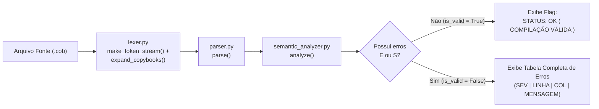

# Plano de Implementação: Analisador Semântico (`semantic_analyzer.py`)

## Objetivo
Implementar o módulo [semantic_analyzer.py](file:///home/coscal/JD/10-19_Projetos/10_Projetos_Correntes/COBython/semantic_analyzer.py), responsável pela **Parte 4 (Análise Semântica / Verificações)** da [ESPECIFICAÇÃO TEXTUAL.txt](file:///home/coscal/JD/10-19_Projetos/10_Projetos_Correntes/COBython/ESPECIFICAÇÃO%20TEXTUAL.txt). O analisador receberá a AST (`ProgramNode`) e a lista de diagnósticos (`list[CompileError]`) vindas do [parser.py](file:///home/coscal/JD/10-19_Projetos/10_Projetos_Correntes/COBython/parser.py), executará todas as validações de escopo, tipo, controle de fluxo e associação de arquivos, e retornará um flag booleano de sucesso junto com a lista consolidada de diagnósticos.

---

## Fluxo do Pipeline até a Análise Semântica



---

## Alterações Propostas

### Analisador Semântico

#### [NEW] [semantic_analyzer.py](file:///home/coscal/JD/10-19_Projetos/10_Projetos_Correntes/COBython/semantic_analyzer.py)

1. **Interface Pública e Integração**:
   - Importará `CompileError`, `make_token_stream` e `expand_copybooks` de [lexer.py](file:///home/coscal/JD/10-19_Projetos/10_Projetos_Correntes/COBython/lexer.py) e `parse`, `ProgramNode` (e demais nós da AST) de [parser.py](file:///home/coscal/JD/10-19_Projetos/10_Projetos_Correntes/COBython/parser.py).
   - Função principal:
     ```python
     def analyze(
         program: ProgramNode, errors: list[CompileError] | None = None
     ) -> tuple[bool, list[CompileError]]:
     ```
     Retorna `(is_valid, errors)`, onde `is_valid` é `True` se e somente se não houver nenhum `CompileError` de severidade `"E"` ou `"S"`.
   - Execução via CLI (`python3 semantic_analyzer.py <arquivo_fonte.cob> [--debug]`):
     - Caso `is_valid == True`: imprime o flag de sucesso (`VALIDAÇÃO CONCLUÍDA: OK — Nenhum erro encontrado.` e eventuais avisos `W`/`I`, se houver) e encerra com código `0`.
     - Caso `is_valid == False`: imprime o flag de falha (`VALIDAÇÃO CONCLUÍDA: FALHA — Foram encontrados erros de compilação.`) seguido da tabela completa de diagnósticos (`SEV | LINHA | COL | MENSAGEM`) e encerra com código `1`.

2. **Tabela de Símbolos (`SymbolTable`)**:
   - **Variáveis e Hierarquia de Dados**:
     - Registra todos os `DataItemNode` da `FILE SECTION` e da `WORKING-STORAGE SECTION`, armazenando para cada entrada (`SymbolEntry`):
       - `name: str`
       - `level: int`
       - `category: str` (`"NUMERIC"`, `"ALPHABETIC"`, `"ALPHANUMERIC"`, `"GROUP"`, `"CONDITION"`, `"INDEX"`)
       - `pic: str | None`
       - `ancestors: tuple[str, ...]` (caminho de grupos pais do nível `01` até o pai imediato, permitindo resolver qualificações `VAR OF GRUPO`)
       - `scope_parent: str` (nome do grupo pai imediato ou `"<ROOT>"` para itens `01` e `77`)
       - `line: int`, `col: int`
     - Também registra automaticamente os índices declarados em cláusulas `OCCURS ... INDEXED BY <id>` (ex.: `TID` em `prog004` e `prog006`) como variáveis de categoria `"INDEX"` (compatíveis com inteiros).
   - **Arquivos e Registros**:
     - `select_files: dict[str, SelectNode]` (arquivos declarados no `FILE-CONTROL`).
     - `fd_files: dict[str, FileDescriptionNode]` (arquivos declarados com `FD` na `FILE SECTION`).
     - `record_to_fd: dict[str, str]` (mapeamento de cada registro `01` dentro de um `FD` para o nome do seu arquivo `FD`, usado para validar `WRITE <registro>`).
   - **Parágrafos e Seções da `PROCEDURE DIVISION`**:
     - `procedures: set[str]` contendo todos os nomes de parágrafos (`ParagraphNode.name`) e seções (`ProcedureSectionNode.name`) declarados na `PROCEDURE DIVISION`.

3. **Regras Semânticas Implementadas (Seção 4 da Especificação)**:

   - **Regra 1 — Compatibilidade de `MOVE` (Seção 4.1)**:
     - Classifica a categoria de tipo a partir da máscara `PIC`:
       - `ALPHABETIC` (`PIC A`): máscara contendo apenas `A` (e opcionalmente `B`/repetições).
       - `NUMERIC` (`PIC 9`): máscara contendo `9`, `Z`, `*`, `S`, `V`, `P`, sinais e pontuação numérica, sem `A` nem `X`.
       - `ALPHANUMERIC` (`PIC X`): máscara contendo `X`, ou combinação de `A` e `9`.
       - `GROUP`: item de grupo sem `PIC` (com subcampos).
     - Verifica cada instrução `MoveStmt(source, targets)`:
       - **Proibido (Erro `E`)**: `source` de categoria `ALPHABETIC` (`PIC A`) para `target` de categoria `NUMERIC` (`PIC 9`).
       - **Proibido (Erro `E`)**: `source` literal alfanumérico não numérico (ex.: `"ABC"` ou `SPACES`) para `target` `NUMERIC` (`PIC 9`).
       - **Proibido (Erro `E`)**: `source` de categoria `NUMERIC` (`PIC 9`, literal `NUMBER` ou constante `ZEROS`) para `target` puramente `ALPHABETIC` (`PIC A`).

   - **Regra 2 — Unicidade de Identificadores e Qualificação por `OF` (Seção 4.2)**:
     - **Unicidade no mesmo escopo**:
       - Se duas variáveis (exceto `FILLER`) tiverem o mesmo nome dentro do mesmo escopo pai (ex.: duas variáveis `77`/`01` no escopo global `<ROOT>`, ou dois subcampos irmãos dentro do mesmo grupo `01`), emite `CompileError("E", ...)` na declaração duplicada.
     - **Resolução e Qualificação (`OF`) nas referências (`IdentifierRef`)**:
       - Percorre todas as instruções e expressões da `PROCEDURE DIVISION` (e cláusulas `FILE STATUS` / `RECORD KEY` do `SELECT`).
       - Se o identificador referenciado não existir na tabela de símbolos: emite `CompileError("E", ...)` informando que a variável não foi declarada na `DATA DIVISION`.
       - Se o identificador existir mais de uma vez em grupos diferentes:
         - Sem qualificador `OF`: emite `CompileError("E", ...)` exigindo qualificação hierárquica (`OF`) por ambiguidade.
         - Com qualificador `OF`: verifica se todos os qualificadores em `ref.qualifiers` aparecem na cadeia `ancestors` de exatamente uma variável; caso não corresponda a nenhuma (ou continue ambíguo), emite `CompileError("E", ...)`.

   - **Regra 3 — Validação de Destinos de Controle (Seção 4.3)**:
     - Para cada `PerformStmt(target, thru)` e `GoToStmt(target)` na `PROCEDURE DIVISION`:
       - Verifica se `target` (e `thru`, quando presente) pertence ao conjunto `procedures` (parágrafos e seções declarados explicitamente na `PROCEDURE DIVISION`).
       - Caso não exista, emite `CompileError("E", stmt.line, stmt.col, ...)`.
     - Também verifica duplicidade de nomes de parágrafos/seções dentro do mesmo escopo da `PROCEDURE DIVISION`.

   - **Regra 4 — Associação de Arquivos (Seção 4.4)**:
     - **Consistência entre `FILE-CONTROL` e `FILE SECTION`**:
       - Todo arquivo declarado em `SELECT <arq>` no `FILE-CONTROL` deve possuir um descritor `FD <arq>` correspondente na `DATA DIVISION` (e vice-versa).
     - **Operações `OPEN`, `READ`, `CLOSE` (e `START`)**:
       - Verifica se o arquivo alvo foi previamente declarado tanto no `FILE-CONTROL` (`SELECT`) quanto em um descritor `FD` na `DATA DIVISION`. Caso falte um dos dois (ou ambos), emite `CompileError("E", ...)`.
     - **Operação `WRITE <registro>`**:
       - Em COBOL, `WRITE` opera sobre o nome do registro `01` associado a um `FD` (ou diretamente sobre o arquivo). Verifica se `<registro>` pertence a um `FD` declarado na `DATA DIVISION` e se o respectivo arquivo possui `SELECT` no `FILE-CONTROL`. Caso contrário, emite `CompileError("E", ...)`.

---

## Plano de Verificação

### Testes Automatizados
1. **Validação dos programas corretos (`test.cob` e fluxos `prog001` a `prog007`)**:
   ```bash
   python3 semantic_analyzer.py test.cob
   ```
   E execução automatizada sobre os 7 programas de exemplo (`prog001` a `prog007`), garantindo que todos retornem `is_valid = True` (`0` erros `E`/`S`).

2. **Validação dos programas com erros (`resultados_lexer/erros/*.cob`)**:
   ```bash
   for f in resultados_lexer/erros/*.cob; do python3 semantic_analyzer.py "$f"; done
   ```
   Verificando que além dos erros léxicos/sintáticos, erros semânticos decorrentes (como `WRK-VALOR1` não declarada em `prog002_operacoes.cob`, `CONT` não declarada em `prog005_strings.cob`, `IDX` não declarada em `prog006_files.cob` e `WS-OPCAO` não declarada em `prog007_loja.cob`) sejam todos capturados e exibidos.

3. **Testes Unitários das 4 Regras da Seção 4**:
   - **Regra 1**: `MOVE VAR-ALFA (PIC A) TO VAR-NUM (PIC 9)`, `MOVE "TEXTO" TO VAR-NUM (PIC 9)`, `MOVE 123 TO VAR-ALFA (PIC A)`.
   - **Regra 2**: Variáveis duplicadas no mesmo escopo; variáveis de mesmo nome em grupos distintos referenciadas sem `OF` (erro de ambiguidade) vs. referenciadas com `OF` (válido); variável não declarada.
   - **Regra 3**: `PERFORM PARAGRAFO-INEXISTENTE` e `GO TO DESTINO-INEXISTENTE`.
   - **Regra 4**: `OPEN`/`READ`/`CLOSE` de arquivo sem `SELECT` ou sem `FD`; `WRITE` de registro não associado a `FD`/`SELECT`.

### Verificação Manual
- Executar `python3 semantic_analyzer.py <arquivo.cob>` no terminal para visualizar o flag de validação e a listagem de erros.
