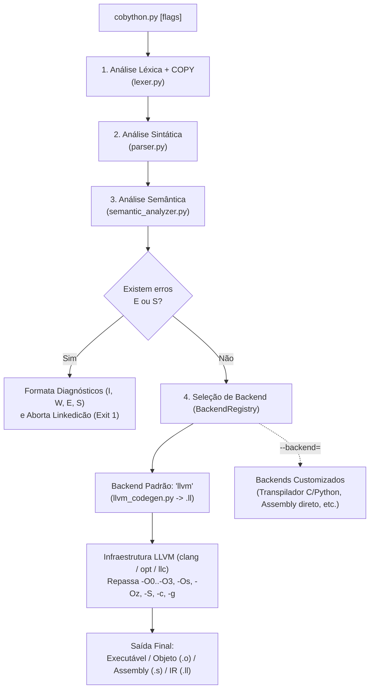

# Plano de Implementação: Driver de Compilação `cobython.py` e Sistema de Diagnósticos (Seção 6)

## Objetivo
Criar o arquivo [cobython.py](file:///home/coscal/JD/10-19_Projetos/10_Projetos_Correntes/COBython/cobython.py) como interface de linha de comando unificada do compilador **COBython** (ao estilo `gcc` / `clang`), integrando todas as fases do pipeline ([lexer.py](file:///home/coscal/JD/10-19_Projetos/10_Projetos_Correntes/COBython/lexer.py), [parser.py](file:///home/coscal/JD/10-19_Projetos/10_Projetos_Correntes/COBython/parser.py), [semantic_analyzer.py](file:///home/coscal/JD/10-19_Projetos/10_Projetos_Correntes/COBython/semantic_analyzer.py) e [llvm_codegen.py](file:///home/coscal/JD/10-19_Projetos/10_Projetos_Correntes/COBython/llvm_codegen.py)), oferecendo uma arquitetura plugável para adição de novos transpiladores ou geradores de assembly direto, repassando flags de otimização e código para a infraestrutura LLVM, e implementando de ponta a ponta os **4 níveis de severidade de erro (`I`, `W`, `E`, `S`)** da **Seção 6 da [ESPECIFICAÇÃO TEXTUAL.txt](file:///home/coscal/JD/10-19_Projetos/10_Projetos_Correntes/COBython/ESPECIFICAÇÃO%20TEXTUAL.txt)**.

---

## 1. Arquitetura do Driver `cobython.py` e Backends Plugáveis



---

## 2. Mapeamento dos Níveis de Severidade (Seção 6) no Pipeline

Conforme a Seção 6 da especificação, o compilador emitirá diagnósticos estruturados nos 4 níveis de severidade:

| Nível | Significado (Seção 6) | Etapa do Pipeline | Situações Diagnosticadas | Comportamento no Compilador |
| :---: | :--- | :--- | :--- | :--- |
| **`I`** | **Informational** (Sugestões de estilo ou otimização) | `semantic_analyzer.py` / `parser.py` | • Variável declarada na `WORKING-STORAGE SECTION` mas nunca referenciada na `PROCEDURE DIVISION` (sugestão de otimização de memória).<br>• Bloco condicional `IF` encerrado apenas pelo ponto `.` da sentença sem `END-IF` explícito (sugestão de estilo moderno COBOL-85).<br>• Parágrafo declarado mas nunca referenciado nem alcançado se após `STOP RUN`. | Exibido ao usuário (pode ser ocultado com `-Wno-info` ou `-w`); **não** impede a compilação. |
| **`W`** | **Warning** (Alertas de potenciais ambiguidades) | `lexer.py` / `parser.py` / `semantic_analyzer.py` | • **Lexer**: Expansão de caractere `\t` (tabulação) em formato fixo; indicador `-` de continuação sem literal ou palavra.<br>• **Parser**: Violação de Área A / Área B (ex.: níveis `01` ou `77` na Área B; comandos na Área A).<br>• **Semântico**: Potencial truncamento em `MOVE` quando a variável de origem tem tamanho físico maior que a variável de destino; uso da instrução `GO TO` (alerta de fluxo não estruturado). | Exibido ao usuário (ou promovido a erro com `-Werror`); **não** impede a compilação. |
| **`E`** | **Error** (Erros léxicos, sintáticos ou semânticos graves) | `lexer.py` / `parser.py` / `semantic_analyzer.py` | • **Lexer**: Indicador inválido na coluna 7, literal não fechado, palavra inválida, identificador > 30 caracteres, copybook não encontrado ou `COPY` malformado.<br>• **Parser**: Divisões obrigatórias ausentes ou fora de ordem, falta de `PROGRAM-ID`, nível inválido, item elementar sem `PIC`, falta de `.` ao fim de sentença, instruções malformadas.<br>• **Semântico**: `MOVE` incompatível (`PIC A` $\leftrightarrow$ `PIC 9`), identificadores duplicados ou ambíguos sem `OF`, variável não declarada, destino de `PERFORM`/`GO TO` inexistente, arquivo sem `SELECT` ou `FD`. | **Impede a geração de código e a linkedição**, retornando código de saída `1`. |
| **`S`** | **Severe** (Falha catastrófica no processo de compilação) | `lexer.py` / `cobython.py` | • **Lexer**: Inclusão recursiva (ciclo infinito) de `COPY` copybooks.<br>• **Driver (`cobython.py`)**: Arquivo fonte inexistente ou ilegível; arquivo fonte sem nenhum token válido; falha interna na ferramenta externa de backend (`clang` / `llc` / plugin). | **Interrompe imediatamente o pipeline**, retornando código de saída `1`. |

---

## 3. Alterações Propostas

### 3.1 Aprimoramento dos Diagnósticos Semânticos (`I` e `W`)

#### [MODIFY] [semantic_analyzer.py](file:///home/coscal/JD/10-19_Projetos/10_Projetos_Correntes/COBython/semantic_analyzer.py)
- Adicionar rastreamento de variáveis referenciadas (`referenced_symbols: set[tuple[str, str]]`) durante a varredura da `PROCEDURE DIVISION` e do `FILE-CONTROL`:
  - Emitir diagnóstico nível **`I`** (*Informational*) para variáveis declaradas na `WORKING-STORAGE SECTION` que nunca são utilizadas (nem elas, nem seus grupos pais, nem seus subcampos filhos).
- Emitir diagnóstico nível **`I`** (*Informational*) quando uma instrução `IfStmt` possui `has_end_if == False` (*"Sugestão de estilo: considere encerrar o comando IF com END-IF explícito"*).
- Emitir diagnóstico nível **`W`** (*Warning*) em `GoToStmt` (*"Uso de GO TO pode introduzir ambiguidade no fluxo de controle; prefira PERFORM"*).
- Emitir diagnóstico nível **`W`** (*Warning*) em `MoveStmt` quando uma variável elementar de origem possui tamanho em bytes estritamente maior que o tamanho da variável elementar de destino (*"Potencial truncamento de dados no MOVE"*).
- Manter 100% de compatibilidade com a assinatura `analyze(program, errors) -> tuple[bool, list[CompileError]]`, onde `is_valid` continua sendo `True` sempre que não houver erros de nível `E` ou `S`.

---

### 3.2 Refatoração do Backend LLVM para Suportar Flags de Otimização e Emissão

#### [MODIFY] [llvm_codegen.py](file:///home/coscal/JD/10-19_Projetos/10_Projetos_Correntes/COBython/llvm_codegen.py)
- Atualizar `try_compile_llvm_ir` (e adicionar `compile_with_llvm_toolchain`) para aceitar opções de compilação:
  - `opt_level: str` (`-O0`, `-O1`, `-O2`, `-O3`, `-Os`, `-Oz`)
  - `output_mode: str`:
    - `"executable"` (padrão): compila `.ll` $\to$ binário executável via `clang -O<n> <arq.ll> -lm -o <saida>` (ou `opt` + `llc` + `gcc`).
    - `"llvm-ir"` (`-S -emit-llvm` ou `--emit-llvm`): gera o arquivo `.ll` (e se `opt` ou `clang -S -emit-llvm -O<n>` for solicitado com otimização $>0$, aplica o otimizador LLVM sobre o `.ll`!).
    - `"assembly"` (`-S`): gera o assembly nativo `.s` da máquina alvo via `clang -S -O<n> <arq.ll> -o <saida.s>` (ou `llc -O<n>`).
    - `"object"` (`-c`): gera o código objeto `.o` não linkado via `clang -c -O<n> <arq.ll> -o <saida.o>` (ou `llc -filetype=obj`).
  - `debug_info: bool` (`-g`): repassa `-g` ao `clang`.
  - `extra_llvm_flags: list[str]` (`-mllvm ...`, `-march=...`): repassadas diretamente ao `clang` / `llc`.

---

### 3.3 Driver Principal estilo GCC/Clang e Sistema de Plugins

#### [NEW] [cobython.py](file:///home/coscal/JD/10-19_Projetos/10_Projetos_Correntes/COBython/cobython.py)

1. **Interface de Linha de Comando (`argparse` estilo GCC/Clang)**:
   ```text
   uso: cobython.py [opções] <arquivo.cob>
   ```
   - **Controle de Fase de Compilação**:
     - *(Padrão)*: Compila até gerar o executável binário.
     - `-fsyntax-only`: Executa apenas análise léxica, sintática e semântica (sem gerar código).
     - `-S`: Para após gerar código assembly nativo (`.s`), ou LLVM IR (`.ll`) se usado com `-emit-llvm`.
     - `-c`: Compila e monta gerando apenas o arquivo objeto (`.o`), sem executar o *linker*.
     - `-emit-llvm`: Emite a representação intermediária LLVM (`.ll` com `-S` ou por padrão se sem `-c`, e bitcode `.bc` com `-c`).
     - `-o <arquivo>`: Define o caminho do arquivo de saída.
   - **Flags de Otimização e Geração (repassadas ao LLVM)**:
     - `-O0`, `-O1`, `-O2`, `-O3`, `-Os`, `-Oz`: Nível de otimização repassado ao `clang` / `opt` / `llc`.
     - `-g`, `--debug`: Ativa a compilação de linhas de depuração (`D` na coluna 7 do COBOL) e símbolos de debug no LLVM.
     - `-I <diretorio>`: Adiciona diretórios de busca para copybooks da diretiva `COPY`.
     - `-Xllvm <flag>`: Repassa flags extras diretamente para a infraestrutura LLVM.
   - **Flags de Diagnóstico e Severidade (Seção 6)**:
     - `-Wall`: Exibe todos os diagnósticos (`I`, `W`, `E`, `S`).
     - `-Wno-info`: Oculta mensagens informativas de nível `I`.
     - `-w`: Suprime avisos (`W`) e informações (`I`), exibindo apenas erros (`E` e `S`).
     - `-Werror`: Trata todos os avisos (`W`) como erros (`E`), impedindo a compilação/linkedição.
   - **Flags de Inspeção e Extensibilidade (Backends Plugáveis)**:
     - `--backend <nome_ou_arquivo.py>`: Seleciona o gerador de código (padrão: `llvm`). Permite carregar qualquer módulo Python externo que implemente a classe/função de backend (ex.: um transpilador C/Python ou gerador de assembly direto).
     - `--list-backends`: Lista os backends registrados e explica o protocolo para adicionar novos.
     - `--dump-tokens`: Exibe a tabela de tokens da etapa léxica.
     - `--dump-ast`: Exibe a Árvore Sintática Abstrata (AST) da etapa sintática.
     - `-v`, `--verbose`: Exibe cada etapa executada e os comandos exatos invocados na infraestrutura LLVM.

2. **Protocolo Plugável de Backends (`CodegenBackend`)**:
   - Define uma classe base clara `CodegenBackend`:
     ```python
     class CodegenBackend:
         name: str
         default_extension: str

         def generate(self, program: ProgramNode, options: CompilerOptions) -> str:
             """Transforma a AST validada no código alvo (IR, código C/Python ou Assembly)."""
             raise NotImplementedError

         def compile_output(self, generated_path: str, output_path: str, options: CompilerOptions) -> tuple[bool, str]:
             """Opcionalmente invoca o montador/compilador nativo sobre o arquivo gerado."""
             return True, f"Arquivo gerado em '{generated_path}'"
     ```
   - Inclui o `LLVMBackend` (padrão, conectado ao `llvm_codegen.py`) e suporte dinâmico via `importlib.util` para carregar qualquer arquivo `.py` passado em `--backend meu_transpilador.py`.

3. **Formatação de Diagnósticos Estilo GCC/Clang (Seção 6)**:
   - Além da tabela resumida, exibe cada diagnóstico apontando para o arquivo, linha, coluna, nível de severidade colorido/identificado (`[I - INFORMATIONAL]`, `[W - WARNING]`, `[E - ERROR]`, `[S - SEVERE]`), a linha original do código-fonte e um cursor `^` na coluna exata do problema:
     ```text
     test.cob:16:12: [W - WARNING] Nível 77 deveria iniciar na Área A (colunas 8-11)
        16 |            77 WRK-VALOR1 PIC 9(10) VALUES 10.
           |            ^
     ```

---

## 4. Plano de Verificação

### Testes Automatizados
1. **Compilação padrão e com níveis de otimização (`-O0`, `-O2`, `-O3`)**:
   ```bash
   python3 cobython.py test.cob -o test_bin && ./test_bin
   python3 cobython.py test.cob -O3 -o test_o3 && ./test_o3
   ```
2. **Emissão de LLVM IR (`-S -emit-llvm`), Assembly nativo (`-S`) e Objeto (`.o` com `-c`)**:
   ```bash
   python3 cobython.py test.cob -S -emit-llvm -O2 -o test_opt.ll
   python3 cobython.py test.cob -S -O2 -o test.s
   python3 cobython.py test.cob -c -O2 -o test.o
   ```
3. **Verificação dos 4 Níveis de Severidade (`I`, `W`, `E`, `S`) e flags `-Werror` / `-w`**:
   - Testar programas que disparam cada um dos 4 níveis (`I`, `W`, `E`, `S`) e validar os códigos de saída (`0` quando há apenas `I`/`W`, `1` quando há `E`/`S` ou `W` com `-Werror`).
4. **Teste de Backend Plugável Customizado**:
   - Testar o carregamento de um backend customizado via `--backend` para validar a extensibilidade.

### Verificação Manual
- Executar `python3 cobython.py --help` e testar os modos de compilação no terminal.
